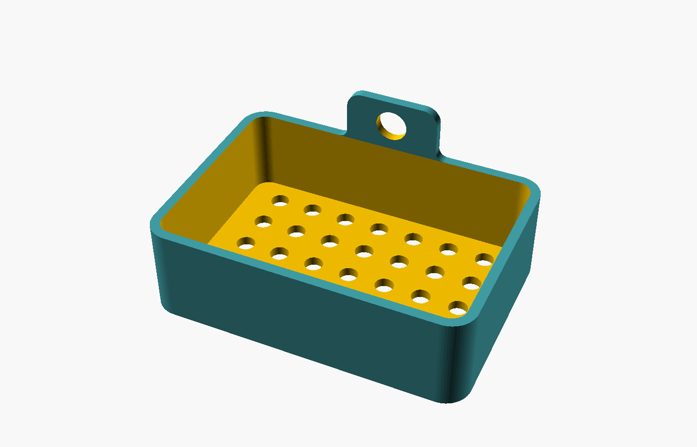
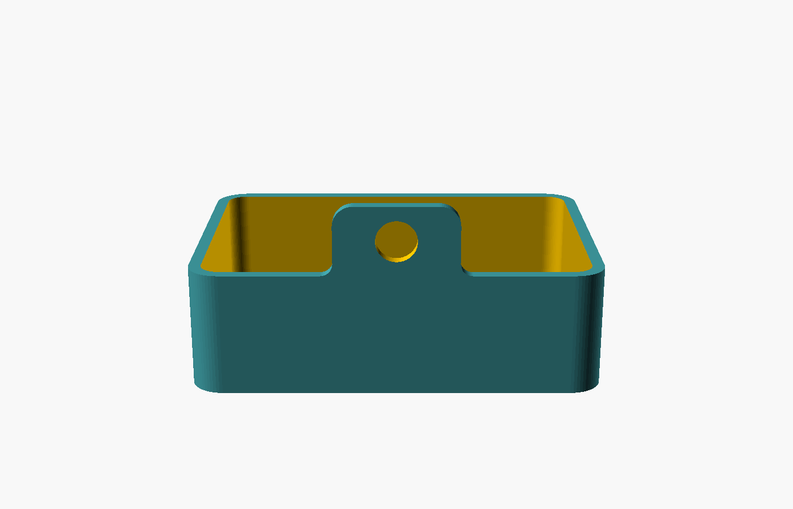

# Khay bông tắm treo tường

Parametric bath sponge tray with drainage and one or two hanging holes. Editable OpenSCAD sources are available with English or Vietnamese parameter descriptions. Preview images are digital renders; no physical print, hook fit or load rating has been validated.

Bản Python cho Autodesk Fusion ở [`fusion/BathSpongeTray`](fusion/BathSpongeTray). Script tạo mô hình native với User Parameters và công thức cập nhật trong **Change Parameters**. Xem [cách chạy, thông số và trạng thái kiểm chứng](fusion/README.md); chưa kiểm chứng dựng mô hình thực tế trong Fusion.

Khay hở miệng, một khối, thân khay **100 × 70 × 30 mm**. Bản mặc định có tai treo cao thêm 17 mm, tổng chiều cao **47 mm**.

- Thành và đáy dày 3 mm; lòng khay 94 × 64 mm, sâu 27 mm.
- Góc ngoài bo R8, góc lòng R5 theo mặt bằng.
- Đáy có 35 lỗ Ø6 mm theo lưới 7 × 5, bước 12 mm.
- `hook_count = 1` (mặc định): tai treo ở giữa thành sau rộng 30 mm, dày 3 mm cùng thành khay, nhô cao 17 mm, bo góc R5. Lỗ móc Ø10 mm tự căn giữa phần tai nhô theo cả chiều ngang và chiều cao: tâm X=50 mm, cao 38,5 mm tính từ đáy ngoài. Phần nhựa phía trên và dưới lỗ đều 3,5 mm. Khi đổi `ear_rise`, tâm lỗ tự cập nhật theo `height + ear_rise / 2`.
- Hai chân tai chuyển tiếp vào mép thành bằng fillet lõm R3 theo mặt đứng, giữ độ dày 3 mm. Chỉnh bằng `ear_root_radius` trong Customizer.
- `hook_count = 2`: hai lỗ Ø10 mm trên thành sau, cách tâm 60 mm; tâm cách hai đầu 20 mm, cao 20 mm. Bản này không có tai nhô và cao tổng cộng 30 mm. Có thể chỉnh `hook_spacing` trong Customizer, trong giới hạn hình học; khoảng cách cũ 100 mm không vừa thân dài 100 mm.
- Tai treo cao giúp điểm treo nằm trên thân khay. Thành sau cần tựa tường để hạn chế lắc; một lỗ tròn không khóa xoay tuyệt đối, nhất là khi móc lỏng hoặc đặt đồ lệch tâm. Chưa kiểm tra cân bằng bằng bản in thực tế.
- Không kèm móc, vít hay phụ kiện gắn tường. Khi treo, móc cần có hình dạng giữ được khay; chưa kiểm tra độ vừa với móc thật hoặc tải chịu lực.





## File và chỉnh sửa

- `khay-bong-tam.scad`: bản tiếng Anh, có mô tả đầy đủ các thông số trong Customizer.
- `khay-bong-tam-vi.scad`: bản tiếng Việt có dấu cho nhóm, mô tả và lựa chọn số lỗ trong Customizer; lưu UTF-8.
- Cả hai file độc lập, dùng cùng tên biến tiếng Anh, giá trị mặc định và hình học. Khi sửa thiết kế, cập nhật cả hai bản để giữ đồng nhất.
- `exports/khay-bong-tam.stl`: mesh để mở trong slicer; dùng đơn vị mm, tỷ lệ 100%.
- `exports/khay-bong-tam-2-lo.stl`: tùy chọn hai lỗ treo.
- `exports/audit.json`: kết quả kiểm tra hình học mặc định.

Đặt đáy phẳng xuống bàn in, miệng hướng lên. Kiểm tra phần bắc cầu trên lỗ treo trong slicer. Chưa có bản in thử, profile máy in, kiểm tra tải chịu lực hoặc thoát nước thực tế.

## Build và kiểm tra

Chạy từ thư mục project. Cần OpenSCAD có backend Manifold trong PATH và Python có các thư viện audit:

```powershell
powershell -NoProfile -ExecutionPolicy Bypass -File .\build.ps1
python -m pip install -r requirements.txt
python audit.py
python audit.py --two-hooks
```

Nếu OpenSCAD chưa có trong PATH, truyền đường dẫn executable bằng `-OpenSCADExecutable 'path/to/openscad.com'` trên Windows. Build dùng backend Manifold, đã kiểm tra bằng OpenSCAD nightly 2026.09.29. Audit dùng `numpy`, `trimesh` và `networkx`; kiểm tra kích thước, mesh kín, một khối liền và các lỗ bằng mặt cắt STL. Khi đổi thông số, cần cập nhật kỳ vọng trong audit trước khi kiểm tra biến thể. Source SCAD không cần thư viện ngoài. `ExecutionPolicy Bypass` chỉ áp dụng cho tiến trình build, không đổi thiết lập PowerShell của máy.

## Ảnh mô phỏng vật liệu

Các ảnh trong `exports/photoreal/` là ảnh AI mô phỏng nhựa FDM, không phải ảnh chụp bản in. Dùng source SCAD và STL làm chuẩn hình học.

## Bộ tài liệu agent tự học.

[Bộ hướng dẫn chung STL, OpenSCAD và Fusion](https://github.com/TimTini/snaplock-storage-box/blob/main/docs/guides/README.md) có [điểm vào cho agent](https://github.com/TimTini/snaplock-storage-box/blob/main/docs/guides/START-HERE.md), quy trình theo đầu vào, thiết lập chuyển máy, template và registry nguồn. Các hồ sơ của project này là ví dụ có phạm vi riêng.
